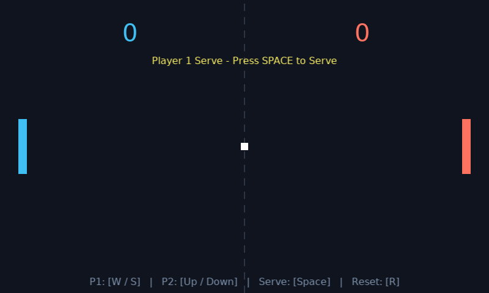
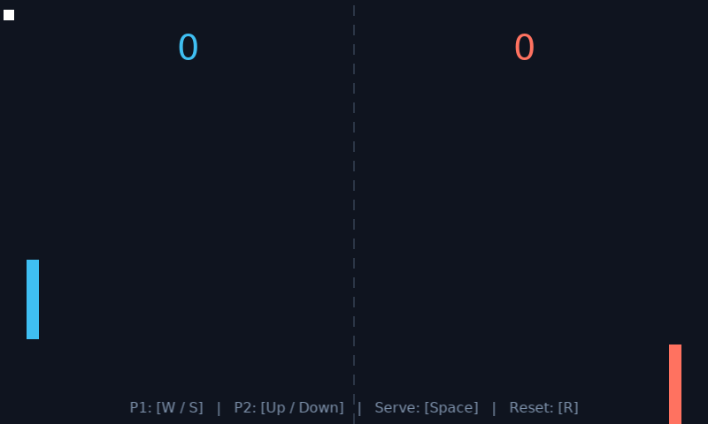

# Pong Game - Love2D

**Student Name:** Yaqoub Al-Hanbali (يعقوب الحنبلي)  
**Section:** اثنين اربعاء 
**Project:** Pong Game in Love2D  

---

## Game Description

This project is an implementation of the classic Pong game built using Lua and the Love2D framework. The game features two paddles on opposite sides of the screen that players move vertically to volley a ball back and forth. It implements time-based movement with delta time (`dt`) so that the game runs at the same speed on any monitor refresh rate, axis-aligned bounding box (AABB) collision detection with position correction to prevent the ball from getting stuck in paddles, wall bouncing, scoring, and an interactive serve system.

---

## Demo & Screenshot

### Gameplay Demo


> Full video available at: [`demo/pong_demo.mp4`](demo/pong_demo.mp4)

### Screenshot


---

## Controls

* **Left Paddle (Player 1):** `W` to move up, `S` to move down
* **Right Paddle (Player 2):** `Up Arrow` to move up, `Down Arrow` to move down
* **Serve Ball:** Press `Space`
* **Restart Match:** Press `R` (resets scores to 0-0 and centers ball)
* **Exit:** Press `Escape`

---

## How to Run

1. Make sure [Love2D](https://love2d.org) is installed on your computer.
2. Open terminal / command prompt in this project folder:
   ```bash
   cd pong-love2d
   ```
3. Run the game:
   ```bash
   love .
   ```

---

## Custom Feature (My Own Changes)

1. **Custom Paddle Colors:**
   * Player 1 paddle is colored bright Cyan.
   * Player 2 paddle is colored Coral / Orange.
   * Scores match the respective player's paddle color.

2. **Ball Speedup on Paddle Hit:**
   * Every time a paddle hits the ball, the horizontal speed increases by 4% (`ball.dx = -ball.dx * 1.04`).
   * This makes rallies progressively faster and more competitive the longer the ball stays in play.

3. **Serve Mechanic & Score Reset:**
   * The round starts in a `'serve'` state where players can position their paddles and press `Space` to start.
   * When a player scores, the score increments and the game pauses in `'serve'` state so players can get ready for the next round.
   * Pressing `R` resets both scores back to 0.

---

## Technical Explanations

### 1. The Three Core Callbacks
* **`love.load()`**: Runs once when the game starts up. It is used to set the window dimensions (`800x480`), title, background color, load fonts, and initialize the paddle and ball tables.
* **`love.update(dt)`**: Runs every frame before drawing. It handles keyboard input polling (`love.keyboard.isDown`), updates ball and paddle positions, detects collisions, and handles scoring.
* **`love.draw()`**: Runs every frame after `love.update`. Its sole responsibility is to render graphics on screen (the dashed net, scores, paddles, ball, and UI text).

### 2. Delta Time (`dt`)
Delta time represents the number of seconds that have passed since the previous frame. If we moved paddles or the ball by a fixed pixel amount each frame (e.g., `y = y + 5`), the game would run much faster on a 144Hz monitor than on a 60Hz monitor. Multiplying speed by `dt` (`y = y + speed * dt`) ensures that movement is measured in pixels per second, giving identical movement speed regardless of frame rate.

### 3. Ball Velocity (`ball.dx` and `ball.dy`)
The ball table stores its horizontal velocity (`dx`) and vertical velocity (`dy`). Each frame in `love.update(dt)`, the position is updated:
```lua
ball.x = ball.x + ball.dx * dt
ball.y = ball.y + ball.dy * dt
```
When the ball hits the top wall (`ball.y <= 0`) or bottom wall (`ball.y + ball.height >= WINDOW_HEIGHT`), reversing `ball.dy = -ball.dy` causes the ball to bounce off at an equal angle.

### 4. AABB Collision & Anti-Sticking
To detect if the ball hit a paddle, we use Axis-Aligned Bounding Box (AABB) overlap checking:
```lua
local function checkCollision(r1, r2)
    return r1.x < r2.x + r2.width and
           r1.x + r1.width > r2.x and
           r1.y < r2.y + r2.height and
           r1.y + r1.height > r2.y
end
```
When a collision is detected, in addition to reversing `ball.dx`, we immediately push the ball outside the paddle edge:
* For Player 1: `ball.x = player1.x + player1.width`
* For Player 2: `ball.x = player2.x - ball.width`

This repositioning prevents the ball from remaining overlapped in the next frame, eliminating any possibility of the ball vibrating or getting stuck inside the paddle.
